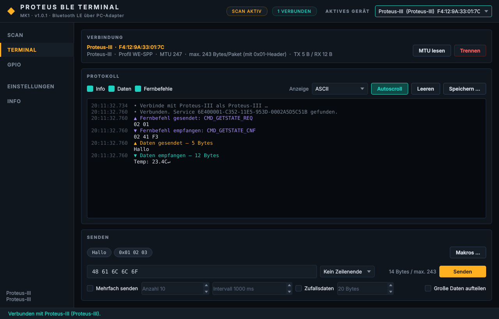
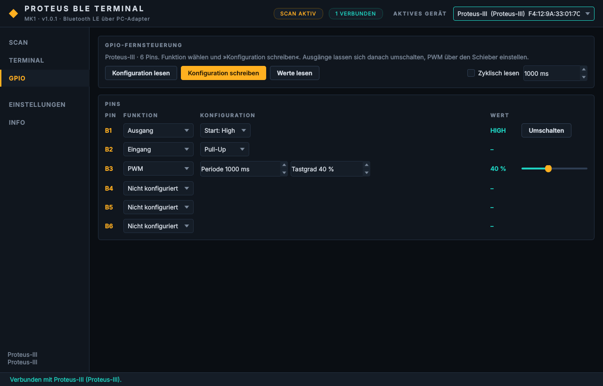

# Proteus-BLE-Terminal-MK1

**Version 1.0.1**



Windows-Desktop-Programm (keine Web-App) zum Testen von Würth-Elektronik-Bluetooth-LE-Funkmodulen
direkt über die Bluetooth-Schnittstelle des PCs oder Laptops – nach dem Vorbild der mobilen App
»WE Bluetooth LE Terminal«. Unabhängiges Projekt, nicht von Würth Elektronik eiSos herausgegeben.

## Funktionen

**Scan**
- Bluetooth-LE-Geräte in der Umgebung suchen (aktiver oder passiver Scan)
- Anzeige von Name, Adresse, RSSI (Balken), erkanntem SPP-Profil, Würth-Herstellerdaten und Beacon-Nutzdaten
- Filter: Name/Adresse, Mindest-RSSI, nur SPP-Profil, nur Würth-Kennung 0x031A, nur Geräte mit Namen
- Sortierung nach RSSI, Name oder Adresse; nicht mehr gesehene Geräte werden ausgegraut
- Verbinden per Doppelklick, Modultyp wird vorgeschlagen und kann geändert werden

**Terminal**
- Mehrere Geräte gleichzeitig verbunden, Umschalten über »Aktives Gerät« in der Kopfzeile
- Protokoll mit Zeitstempel, farbig nach Info / gesendet / empfangen / Fernbefehl, filterbar
- Anzeige als HEX, ASCII oder ASCII (druckbar)
- Senden als HEX oder Text (Escapes `\r \n \t \xNN`), optional mit CR/LF
- Mehrfach senden mit Anzahl und Intervall (ab 50 ms), Abbruch per »Stopp«
- Zufallsdaten mit einstellbarer Länge
- Große Daten automatisch auf mehrere Pakete aufteilen (optional)
- Makros als Schnellknöpfe (anlegen, bearbeiten, sortieren, löschen)
- MTU lesen (bei Proteus-III/-e/Setebos-I zusätzlich Abfrage der max. Nutzdatenlänge)
- Protokoll als TXT oder CSV speichern

**GPIO** (Proteus-III, Proteus-e, Setebos-I)
- Pin-Konfiguration lesen und schreiben: Eingang (Pull-Up/-Down), Ausgang (Startpegel), PWM (Periode, Tastgrad)
- Ausgänge umschalten, PWM per Schieber einstellen, Werte einmalig oder zyklisch lesen
- Anzeige von Pin-Änderungen, die das Modul selbst meldet

**Einstellungen**
- Schreibart (automatisch / mit Antwort / ohne Antwort), Verbindungs-Timeout, Scan-Art
- Eigene Service-/RX-/TX-UUIDs je Profil (für Module mit angepasster Firmware)
- Gespeichert unter `%APPDATA%\Proteus-BLE-Terminal-MK1\settings.json`

## Screenshots

| Scan | GPIO |
|---|---|
|  |  |

## Unterstützte Module

| Modul | Profil | Header | GPIO |
|---|---|---|---|
| Proteus-I, Proteus-II | WE-SPP | 0x01 / 0x02 | – |
| Proteus-III | WE-SPP | 0x01 / 0x02 | B1–B6 (PWM B3–B6) |
| Proteus-e | WE-SPP | 0x01 / 0x02 | B1–B2 |
| Setebos-I | WE-SPP | 0x01 / 0x02 | B2–B6 (PWM B3–B6) |
| Proteus-IV | WE-SPP2 | ohne | – |
| Stephano-I | WE-SPP | ohne | – |
| Skoll-I | CY-SPP | ohne | – |

## Voraussetzungen

- Windows 10 (ab Version 1809) oder Windows 11, 64 Bit
- Bluetooth-Adapter mit Bluetooth Low Energy (ab Bluetooth 4.0), in Windows eingeschaltet
- Die Module müssen **nicht** in Windows gekoppelt werden

## Build per GitHub Actions

1. Inhalt dieser ZIP in ein neues GitHub-Repository hochladen (inklusive des Ordners `.github`).
2. Der Workflow `Build Windows EXE` startet bei jedem Push automatisch
   (oder manuell unter *Actions → Build Windows EXE → Run workflow*).
3. Fertige ZIP unter *Actions → letzter Lauf → Artifacts* herunterladen.
4. Bei einem Tag `v*` (z. B. `v1.0.0`) wird zusätzlich ein Release mit der ZIP erstellt.

Die erzeugte ZIP enthält den Ordner `Proteus-BLE-Terminal-MK1` mit
`Proteus-BLE-Terminal-MK1.exe` und dem Unterordner `_internal` (Laufzeitbibliotheken).
Den Ordner komplett entpacken und die EXE starten – keine Installation nötig.

## Lokal starten (Entwicklung)

```bash
pip install -r requirements.txt
python main.py
```

## Projektstruktur

```
main.py                     Startpunkt
app/__init__.py             Name und Version
app/protocol.py             UUIDs, Modultypen, Header, GPIO-Befehle, Kodierungen
app/ble_worker.py           Bluetooth LE (bleak) im eigenen Thread
app/settings.py             Einstellungen und Makros (JSON)
app/theme.py                Dunkles Dashboard-Design
app/ui/                     Oberfläche (Scan, Terminal, GPIO, Einstellungen, Info)
assets/                     Icon und Grafiken
docs/                       Screenshots für die README
.github/workflows/          Build der EXE
```

## Protokoll-Kurzreferenz (WE-SPP)

- Service `6E400001-C352-11E5-953D-0002A5D5C51B`
- RX (PC → Modul, Write) `6E400002-…`, TX (Modul → PC, Notify) `6E400003-…`
- Nutzdaten: `0x01` + Daten · Fernbefehl: `0x02` + Befehlscode + Parameter
- Befehle: GETSTATE `0x01/0x41`, GPIO WriteConfig `0x28/0x68`, Write `0x29/0x69`,
  Read `0x2A/0x6A`, ReadConfig `0x2C/0x6C`, lokale Änderung `0xA6`
