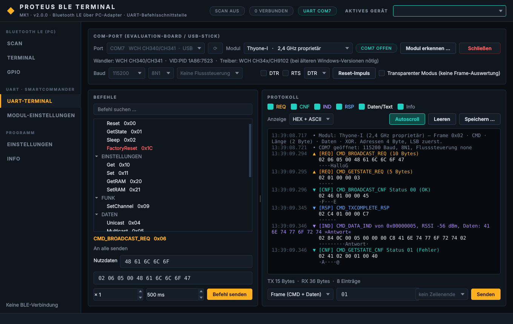
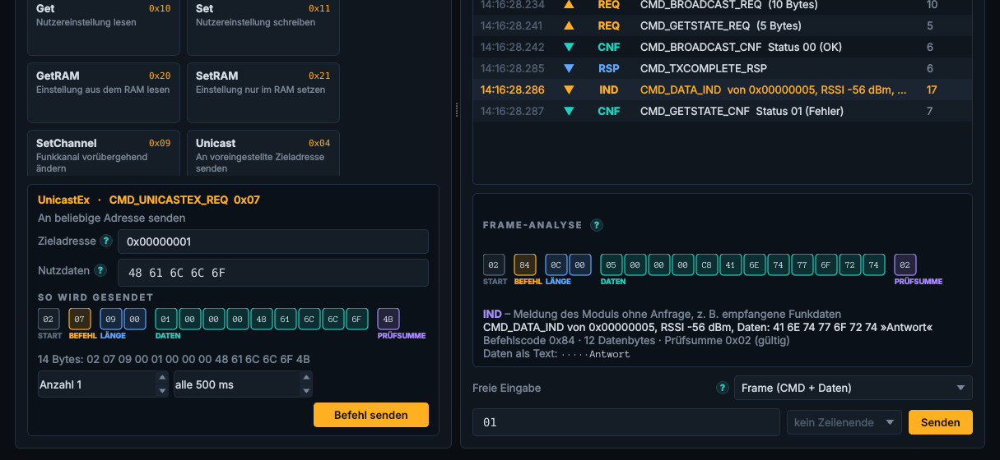
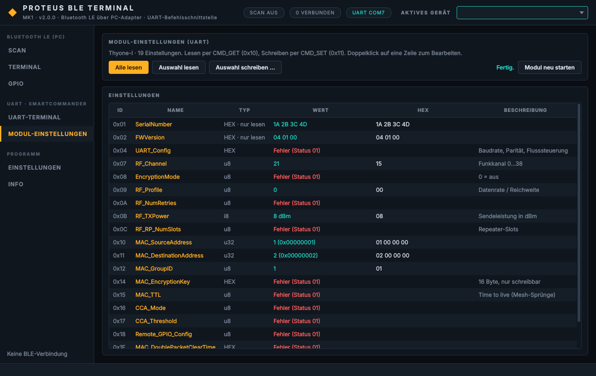
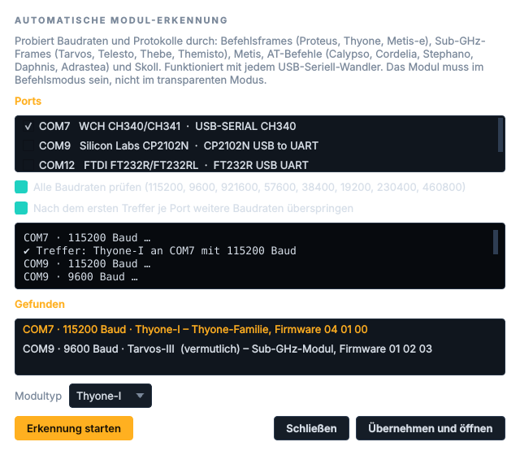
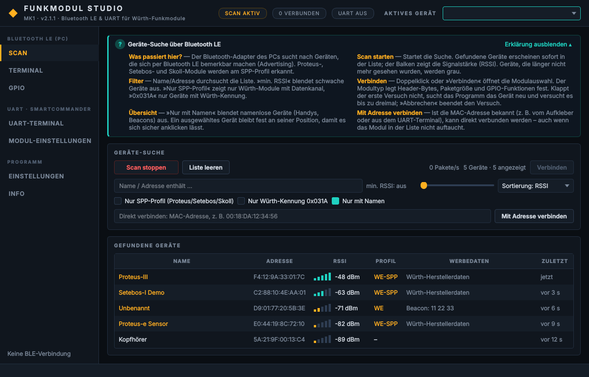

# Funkmodul-Studio-MK1

**Version 2.1.1**


Windows-Desktop-Programm (keine Web-App) zum Testen von Würth-Elektronik-Funkmodulen:

- **Bluetooth LE über den PC-Adapter** – nach dem Vorbild der mobilen App »WE Bluetooth LE Terminal«
- **UART-Befehlsschnittstelle** über Evaluation-Boards und USB-Sticks – mit den Funktionen des
  PC-Tools »WE smartCommander« für Proteus, Thyone, Tarvos, Telesto, Thebe, Themisto, Metis,
  Calypso, Cordelia, Stephano, Daphnis, Adrastea und Skoll

Unabhängiges Projekt, nicht von Würth Elektronik eiSos herausgegeben.

> Früherer Name: *Proteus-BLE-Terminal-MK1*. Einstellungen und Makros der Vorgängerversion werden beim
> ersten Start automatisch übernommen.

Jede Seite hat eine aufklappbare **Erklärung** (»?«), viele Felder zusätzlich kleine »?«-Hinweise mit Tooltip.

## Funktionen

**Scan**
- Bluetooth-LE-Geräte in der Umgebung suchen (aktiver oder passiver Scan)
- Anzeige von Name, Adresse, RSSI (Balken), erkanntem SPP-Profil, Würth-Herstellerdaten und Beacon-Nutzdaten
- Filter: Name/Adresse, Mindest-RSSI, nur SPP-Profil, nur Würth-Kennung 0x031A, nur Geräte mit Namen
- Sortierung nach RSSI, Name oder Adresse; nicht mehr gesehene Geräte werden ausgegraut
- Verbinden per Doppelklick, Modultyp wird vorgeschlagen und kann geändert werden
- Verbinden direkt über die MAC-Adresse; bis zu drei Versuche mit erneuter Suche, Abbruch jederzeit
- Auch bei sehr vielen Bluetooth-Geräten in der Umgebung flüssig: Ergebnisse werden gesammelt und
  gedrosselt angezeigt, ein ausgewähltes Gerät springt nicht mehr weg; Anzeige der Pakete pro Sekunde

**Terminal**
- Mehrere Geräte gleichzeitig verbunden, Umschalten über »Aktives Gerät« in der Kopfzeile
- Protokoll mit Zeitstempel, farbig nach Info / gesendet / empfangen / Fernbefehl, filterbar
- Anzeige als HEX, ASCII oder ASCII (druckbar)
- Senden als HEX oder Text (Escapes `\r \n \t \xNN`), optional mit CR/LF
- Mehrfach senden mit Anzahl und Intervall (ab 50 ms), Abbruch per »Stopp«
- Zufallsdaten mit einstellbarer Länge
- Große Daten automatisch auf mehrere Pakete aufteilen (optional)
- Makros als Schnellknöpfe (anlegen, bearbeiten, sortieren, löschen)
- MTU lesen (bei Proteus-III/-e/Setebos-I zusätzlich Abfrage der max. Nutzdatenlänge)
- Protokoll als TXT oder CSV speichern

**GPIO** (Proteus-III, Proteus-e, Setebos-I)
- Pin-Konfiguration lesen und schreiben: Eingang (Pull-Up/-Down), Ausgang (Startpegel), PWM (Periode, Tastgrad)
- Ausgänge umschalten, PWM per Schieber einstellen, Werte einmalig oder zyklisch lesen
- Anzeige von Pin-Änderungen, die das Modul selbst meldet

**UART-Terminal (smartCommander-Funktionen)** – grafisch aufgebaut
- Verbindung in drei Schritten (Port → Modul → Verbinden) mit Häkchen für erledigte Schritte
- Befehle als Kacheln, nach Gruppen filterbar und durchsuchbar; rote Kacheln = setzt das Modul zurück
- Parameterformular mit Erklärung je Feld und grafischer Vorschau des Frames
  (Start, Befehl, Länge, Daten, Prüfsumme als farbige Byte-Kästchen)
- Protokoll als Tabelle mit farbigen Typen; Klick auf eine Zeile zerlegt den Frame grafisch
  und erklärt Typ, Status und Inhalt
- Kennzahlen: gesendet, empfangen, Fehler, letzter RSSI, Bytes
- **Jeder USB-Seriell-Wandler**, nicht nur FTDI: CP210x, CH340/CH341/CH9102/CH343, PL2303, MCP2221,
  STM32/nRF/RP2040/ESP32-CDC, J-Link-/ST-Link-/DAPLink-VCOM u. a. – der Chip wird anhand der
  USB-IDs erkannt und mit Treiberhinweis angezeigt
- **Automatische Modul-Erkennung**: probiert Ports, Baudraten und Protokolle durch und schlägt
  Modul, Baudrate und Protokoll vor
- Neue oder entfernte Ports werden automatisch erkannt (Board einstecken genügt)
- DTR/RTS werden schon **vor** dem Öffnen gesetzt – CH340, CP210x, PL2303 und CDC-Wandler lösen
  so beim Öffnen keinen ungewollten Reset des Moduls aus
- COM-Port mit Baudrate, Datenformat (8N1, 8E1 …) und Flusssteuerung; Standard-Baudrate je Modul
- Steuerleitungen DTR/RTS schalten und Reset-Impuls senden (Evaluation-Boards)
- Befehlsliste je Modul, gruppiert und durchsuchbar, mit Parameterformular und Frame-Vorschau
- Rahmen (STX, Länge, XOR-Prüfsumme) wird automatisch gebaut; Senden auch wiederholt mit Intervall
- Farbige Auswertung aller Frames: Anfrage (REQ), Bestätigung (CNF), Meldung (IND), Antwort (RSP)
  mit Befehlsname, Status, Absender, RSSI und Nutzdaten
- Freie Eingabe als Frame (nur CMD + Daten), als HEX roh oder als Text/AT-Befehl
- Transparenter Modus ohne Frame-Auswertung
- Protokoll vollständig als TXT oder CSV speicherbar

**Modul-Einstellungen (UART)**
- Alle Nutzereinstellungen des Moduls auf einmal lesen, Werte dekodiert und als HEX anzeigen
- Einzelne Einstellungen bearbeiten und schreiben (mit Prüfung des Wertebereichs), Modul neu starten

**Einstellungen**
- Schreibart (automatisch / mit Antwort / ohne Antwort), Verbindungs-Timeout, Scan-Art
- Eigene Service-/RX-/TX-UUIDs je Profil (für Module mit angepasster Firmware)
- Gespeichert unter `%APPDATA%\Funkmodul-Studio-MK1\settings.json`

## Screenshots



| Befehl & Frame-Analyse | Modul-Einstellungen |
|---|---|
|  |  |

| Modul-Erkennung |
|---|
|  |

| Scan | GPIO |
|---|---|
|  |  |

## UART-Module

| Modul | Funk | Schnittstelle | Standard-Baud |
|---|---|---|---|
| Proteus-II, -III, -e, -IV | Bluetooth LE | Befehlsframes 0x02, 16-Bit-Länge | 115200 |
| Thyone-I, Thyone-e | 2,4 GHz proprietär | Befehlsframes 0x02, 16-Bit-Länge | 115200 |
| Tarvos-III, Tarvos-e | 868 MHz | Befehlsframes 0x02, 8-Bit-Länge | 115200 |
| Telesto-III, Themisto-I | 915 MHz | Befehlsframes 0x02, 8-Bit-Länge | 115200 |
| Thebe-II | 169 MHz | Befehlsframes 0x02, 8-Bit-Länge | 115200 |
| Metis-I / Metis-II | Wireless M-Bus | Befehlsframes 0xFF | 9600 |
| Metis-e | Wireless M-Bus | Befehlsframes 0x02 mit TLV-Optionen | 115200 |
| Calypso, Cordelia-I | WLAN | AT-Befehle | 921600 / 115200 |
| Stephano-I | WLAN + Bluetooth LE | AT-Befehle | 115200 |
| Daphnis-I | LoRaWAN / LoRa P2P | AT-Befehle | 9600 |
| Adrastea-I | LTE-M / NB-IoT + GNSS | AT-Befehle | 115200 |
| Skoll-I | Bluetooth Classic + LE | Text-API | 115200 |

## Bluetooth-LE-Module (PC-Bluetooth)

| Modul | Profil | Header | GPIO |
|---|---|---|---|
| Proteus-I, Proteus-II | WE-SPP | 0x01 / 0x02 | – |
| Proteus-III | WE-SPP | 0x01 / 0x02 | B1–B6 (PWM B3–B6) |
| Proteus-e | WE-SPP | 0x01 / 0x02 | B1–B2 |
| Setebos-I | WE-SPP | 0x01 / 0x02 | B2–B6 (PWM B3–B6) |
| Proteus-IV | WE-SPP2 | ohne | – |
| Stephano-I | WE-SPP | ohne | – |
| Skoll-I | CY-SPP | ohne | – |

## Voraussetzungen

- Windows 10 (ab Version 1809) oder Windows 11, 64 Bit
- Für Bluetooth LE: Adapter mit Bluetooth Low Energy (ab Bluetooth 4.0), in Windows eingeschaltet;
  die Module müssen **nicht** in Windows gekoppelt werden
- Für UART: Evaluation-Board, USB-Stick oder eigenes Board mit beliebigem USB-Seriell-Wandler
  (FTDI, CP210x, CH340, PL2303, CDC …); für CP210x, CH34x und PL2303 ggf. den Herstellertreiber installieren

## Build per GitHub Actions

1. Inhalt dieser ZIP in ein neues GitHub-Repository hochladen (inklusive des Ordners `.github`).
2. Der Workflow `Build Windows EXE` startet bei jedem Push automatisch
   (oder manuell unter *Actions → Build Windows EXE → Run workflow*).
3. Fertige ZIP unter *Actions → letzter Lauf → Artifacts* herunterladen.
4. Bei einem Tag `v*` (z. B. `v1.0.0`) wird zusätzlich ein Release mit der ZIP erstellt.

Die erzeugte ZIP enthält nur eine einzige Datei: `Funkmodul-Studio-MK1.exe`.
Keine Installation und keine Ordner daneben nötig – EXE an einen beliebigen Ort kopieren und starten.
Beim Start entpackt die EXE ihre Laufzeitbibliotheken kurz in einen temporären Windows-Ordner,
der erste Start dauert daher ein bis zwei Sekunden länger.

## Lokal starten (Entwicklung)

```bash
pip install -r requirements.txt
python main.py
```

## Projektstruktur

```
main.py                     Startpunkt
app/__init__.py             Name und Version
app/protocol.py             UUIDs, Modultypen, Header, GPIO-Befehle, Kodierungen
app/ble_worker.py           Bluetooth LE (bleak) im eigenen Thread
app/settings.py             Einstellungen und Makros (JSON)
app/theme.py                Dunkles Dashboard-Design
app/uart/                   UART: Modultabellen, Frames, COM-Port, USB-Chips, Modul-Erkennung
app/ui/                     Oberfläche (Scan, Terminal, GPIO, UART, Modul-Einstellungen, Info)
assets/                     Icon und Grafiken
docs/                       Screenshots für die README
.github/workflows/          Build der EXE
```

## Protokoll-Kurzreferenz (WE-SPP)

- Service `6E400001-C352-11E5-953D-0002A5D5C51B`
- RX (PC → Modul, Write) `6E400002-…`, TX (Modul → PC, Notify) `6E400003-…`
- Nutzdaten: `0x01` + Daten · Fernbefehl: `0x02` + Befehlscode + Parameter
- Befehle: GETSTATE `0x01/0x41`, GPIO WriteConfig `0x28/0x68`, Write `0x29/0x69`,
  Read `0x2A/0x6A`, ReadConfig `0x2C/0x6C`, lokale Änderung `0xA6`
